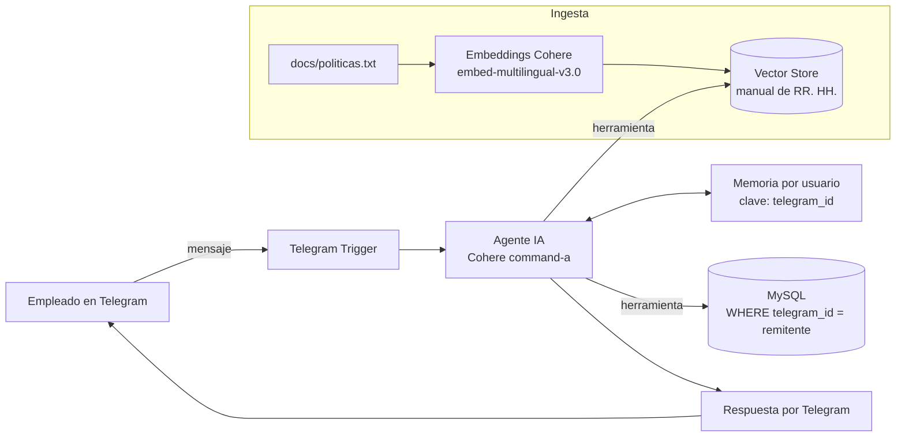

# 🤖 HR Buddy: asistente virtual de RR. HH.


Bot de Telegram con IA que responde consultas de recursos humanos. Combina un agente con **RAG** sobre el manual de políticas de la empresa y consultas a **MySQL** para los datos personales de cada empleado, con memoria conversacional por usuario.

## 📝 Qué hace

- ✅ Consulta el saldo de vacaciones y el banco de horas **del empleado que escribe**
- ✅ Responde preguntas sobre políticas de RR. HH., viajes y horarios a partir del manual
- ✅ Mantiene el contexto de la conversación por usuario
- ✅ Nunca comparte datos de otros empleados

## 🏗️ Arquitectura



El proyecto tiene **dos workflows** de n8n:

| Workflow | Qué hace |
|---|---|
| `workflow/workflow_ingesta.json` | Descarga `docs/politicas.txt`, genera los embeddings con Cohere y los guarda en el Vector Store |
| `workflow/workflow_agente.json` | Recibe los mensajes de Telegram, consulta el Vector Store y MySQL, y responde con el agente |

## 🔐 Seguridad y privacidad

El bot maneja datos personales, así que la identidad del empleado **no depende de lo que escriba en el chat**:

- La consulta a MySQL filtra siempre por el `telegram_id` de quien envía el mensaje. Ese valor lo pone n8n, no el modelo, así que el agente no puede buscar a otra persona aunque se lo pidan.
- La herramienta solo devuelve las columnas necesarias y es de solo lectura.
- Si la cuenta de Telegram no está vinculada a un empleado, el bot no inventa datos y remite a RR. HH.
- Las pruebas de privacidad (pedir datos de otros, listar empleados, prompt injection) están en [`docs/evaluacion.md`](docs/evaluacion.md).

> En la primera versión el bot pedía el nombre y buscaba con `LIKE`, lo que permitía consultar los datos de cualquier empleado escribiendo su nombre. Se corrigió vinculando cada empleado a su cuenta de Telegram.

## 🛠️ Tecnologías

- **n8n**: orquestación de workflows y agente (LangChain)
- **Cohere**: `command-a-03-2025` como modelo y `embed-multilingual-v3.0` para embeddings
- **MySQL 8**: datos de empleados
- **Telegram Bot API**: interfaz de chat
- **Docker Compose**: entorno local con un solo comando

## 🚀 Cómo correrlo

### 1. Clonar y configurar

```bash
git clone https://github.com/Nikotastic/n8n-rh-chatbot.git
cd n8n-rh-chatbot
cp .env.example .env   # edita las contraseñas de MySQL
```

Antes de levantar el entorno, cambia en `db/schema.sql` el `telegram_id` de ejemplo por el tuyo (puedes obtenerlo escribiéndole a [@userinfobot](https://t.me/userinfobot)).

### 2. Levantar n8n y MySQL

```bash
docker compose up -d
```

MySQL crea la tabla `empleados` y el dato de ejemplo automáticamente. n8n queda en `http://localhost:5678`.

### 3. Importar los workflows

1. En n8n ve a **Workflows → Import from File** e importa los dos archivos de `workflow/`.
2. Configura las credenciales en n8n:
   - **Telegram**: token del bot creado con [@BotFather](https://t.me/BotFather)
   - **Cohere**: API key de [cohere.com](https://cohere.com)
   - **MySQL**: host `mysql`, puerto `3306` y los datos de tu `.env`

### 4. Cargar el manual

Abre `workflow_ingesta.json` y haz clic en **Execute Workflow**.

> ⚠️ El Simple Vector Store de n8n vive en memoria: si reinicias n8n, vuelve a ejecutar la ingesta.

### 5. Activar el agente

Activa `workflow_agente.json` y escríbele al bot en Telegram.

## 💬 Ejemplo

```
👤 ¿Cuántos días de vacaciones me quedan?
🤖 Hola Rafael, tienes 12 días de vacaciones disponibles.

👤 ¿Cuál es la política de trabajo remoto?
🤖 Según el manual de ChocolaTech, el trabajo remoto...
```


## 📁 Estructura

```
n8n-rh-chatbot/
├── workflow/
│   ├── workflow_ingesta.json   # Carga del manual al Vector Store
│   └── workflow_agente.json    # Agente de Telegram
├── db/
│   └── schema.sql              # Tabla de empleados y dato de ejemplo
├── docs/
│   ├── politicas.txt           # Manual de RR. HH. (base de conocimientos)
│   ├── evaluacion.md           # Preguntas de prueba
│   └── img/demo.jpg
├── docker-compose.yml
├── .env.example
└── README.md
```

## 🧭 Próximos pasos

- Cambiar el Vector Store en memoria por uno persistente (pgvector o Qdrant)
- Soportar notas de voz con transcripción
- Automatizar la evaluación de respuestas

## 📚 Contexto

Proyecto desarrollado durante una formación práctica en automatización e inteligencia artificial con n8n, y mejorado después con foco en seguridad de datos personales y facilidad de despliegue.
