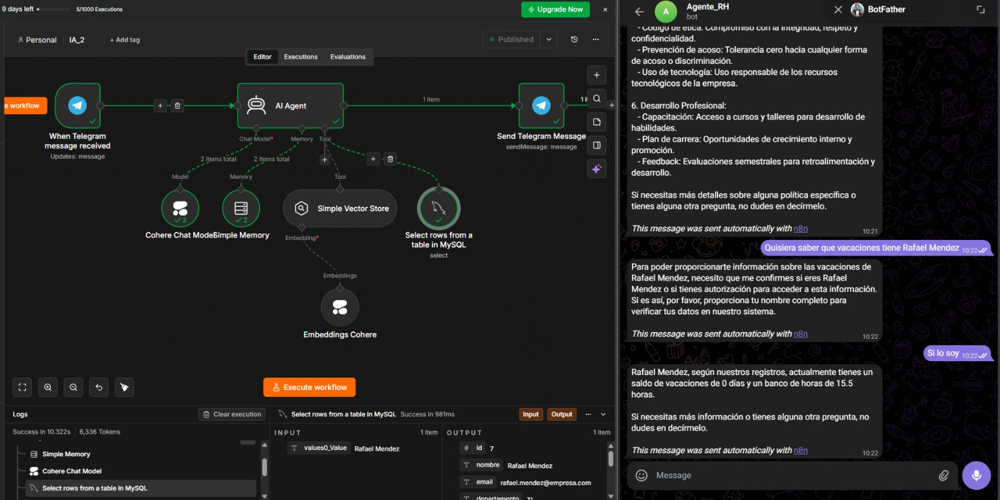

# 🤖 HR Buddy - Asistente Virtual de RR.HH.


Bot de Telegram con IA para gestión de recursos humanos usando n8n, Cohere y MySQL.

## 📝 Descripción

HR Buddy es un asistente virtual inteligente que ayuda a los empleados con consultas de RR.HH.:

- ✅ Consulta de saldos de vacaciones
- ✅ Banco de horas
- ✅ Políticas de RR.HH.
- ✅ Información sobre viajes y horarios
- ✅ Memoria conversacional por usuario

## 📚 Contexto del Proyecto

Proyecto desarrollado durante una formación práctica en automatización e inteligencia artificial con n8n, enfocado en la construcción de asistentes virtuales para procesos empresariales. El objetivo principal fue aprender la integración entre Telegram, modelos de lenguaje, bases de datos y flujos automatizados aplicados a escenarios de Recursos Humanos.

## 🏗️ Arquitectura

El proyecto se compone de **dos workflows** independientes en n8n:

| Workflow                | Descripción                                                                                |
| ----------------------- | ------------------------------------------------------------------------------------------ |
| `workflow_ingesta.json` | Descarga el PDF de políticas, lo embebe con Cohere y lo almacena en el Vector Store        |
| `workflow_agente.json`  | Recibe mensajes de Telegram, consulta MySQL y el Vector Store, y responde con el agente IA |

> ⚠️ Debes ejecutar `workflow_ingesta.json` **una sola vez** antes de activar el agente.

## 🛠️ Tecnologías

- **n8n** — Automatización de workflows
- **Telegram Bot API** — Interfaz de chat
- **Cohere** (`command-a-03-2025`) — Modelo de lenguaje y embeddings
- **MySQL** — Base de datos de empleados
- **LangChain (via n8n)** — Agente con RAG y herramientas

## 📦 Requisitos Previos

- Node.js 18+ y npm
- n8n instalado (`npm install -g n8n`)
- Cuenta de Telegram y bot creado con [@BotFather](https://t.me/BotFather)
- API Key de Cohere → https://cohere.com
- Base de datos MySQL activa

## 🚀 Instalación

### 1. Clonar el repositorio

```bash
git clone https://github.com/tu-usuario/n8n-hr-chatbot.git
cd n8n-hr-chatbot
```

### 2. Configurar variables de entorno

```bash
cp .env.example .env
```

Edita .env con tus credenciales reales:

```bash
TELEGRAM_BOT_TOKEN=123456:ABC-DEF1234ghIkl-zyx57W2v1u123ew11
COHERE_API_KEY=tu_api_key_de_cohere
MYSQL_HOST=localhost
MYSQL_DATABASE=rrhh_db
MYSQL_USER=root
MYSQL_PASSWORD=tu_password
```

### 3. Crear tabla en MySQL

```sql
CREATE TABLE empleados (
  id INT AUTO_INCREMENT PRIMARY KEY,
  nombre VARCHAR(255) NOT NULL,
  saldo_vacaciones INT DEFAULT 0,
  banco_horas DECIMAL(5,2) DEFAULT 0,
  departamento VARCHAR(100),
  fecha_ingreso DATE
);

-- Ejemplo de datos
INSERT INTO empleados (nombre, saldo_vacaciones, banco_horas, departamento)
VALUES ('Rafael Mendez', 0, 15.5, 'Tecnología');
```

### 4. Importar workflows en n8n

1. Abre `http://localhost:5678`
2. Ve a **Workflows → Import from File**
3. Importa primero `workflows/workflow_ingesta.json`
4. Luego importa `workflows/workflow_agente.json`
5. En cada workflow, configura las credenciales:
   - **Telegram**: token del bot
   - **Cohere**: API Key
   - **MySQL**: datos de conexión

### 5. Cargar la base de conocimientos (solo una vez)

1. Abre el workflow `workflow_ingesta.json` en n8n
2. Haz clic en **Execute Workflow**
3. Verifica que el Simple Vector Store se haya poblado correctamente

### 6. Activar el agente

Activa el workflow `workflow_agente.json` — a partir de ahora el bot responderá mensajes en Telegram.

## 💬 Uso

Una vez activo, escribe al bot en Telegram:

👤 Tú: ¿Cuántos días de vacaciones me quedan?
🤖 HR Buddy: Hola Rafael, tienes 12 días de saldo de vacaciones disponibles.
👤 Tú: ¿Cuál es la política de trabajo remoto?
🤖 HR Buddy: Según las políticas de la empresa, el trabajo remoto está permitido...

### 🔧 Estructura del Proyecto

```

n8n-hr-chatbot/
├── workflows/
│   ├── workflow_ingesta.json    # Flujo de carga de documentos al Vector Store
│   └── workflow_agente.json     # Flujo del agente de Telegram
├── docs/
│   ├── politicas.txt      # Base de conocimientos (RAG)
│   └── img/
│       └── demo.jpg             # Captura del bot en acción
├── .env.example                 # Plantilla de variables de entorno
├── .gitignore
└── README.md

```

## 📱 Vista Previa del Chatbot

Así se ve HR Buddy funcionando en Telegram:


